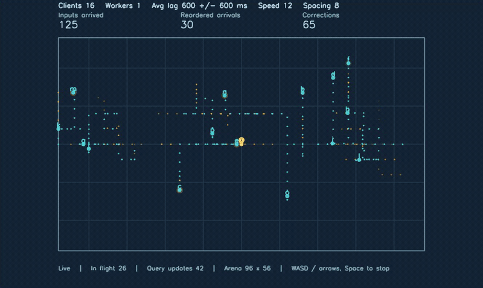

[](https://crates.io/crates/contime)
[](https://docs.rs/contime)
[](https://qlty.sh/gh/humacss/projects/contime)
[](https://qlty.sh/gh/humacss/projects/contime)

# contime

> **Work in progress:** ConTime is still being developed for my own use. There is more cleanup to do, and the API needs further refinement before it is ready for general adoption. You are welcome to try it, but expect changes and rough edges.

`contime` is an in-memory Rust library that builds queryable continuous-time state from unreliable event streams.

It handles delayed, duplicated, and out-of-order events, and distributes independent snapshot histories across workers.

## Reconciliation in action

[][browser-demo]

**[Play the interactive browser demo][browser-demo]** — click the map, then use WASD or the arrow keys. Space stops your client.

Fifteen simulated clients and one keyboard-controlled client move inside a fixed
arena with 600 ms average simulated input latency. Inputs regularly arrive out of order. **Cyan** shows the latest queried
paths; **amber** fades out earlier paths only where those queries now disagree.
Markers ease between queried positions. Each update is checked against an
independent reference. The [Bevy presentation](examples/support/graphics/README.md)
is shared across desktop and browser hosts.

To run it from a checkout, first install the [browser prerequisites](examples/environments/browser/README.md#build-directly),
including Rust 1.95 for the isolated graphics example and the matching wasm-bindgen CLI.
ConTime itself requires Rust 1.90. Then start the example launcher:

```sh
cargo run --release --example launcher
```

Choose **Browser → Manual → Client movement**. Click the map to control a client
with WASD or the arrow keys; Space stops it. The launcher lets you choose client
count and simulated latency before starting. See the [browser setup](examples/environments/browser/README.md#build-directly)
and [recording settings](guides/usage/README.md#reproduce-the-reconciliation-recording),
or try the [terminal version](examples/cases/client_movement/README.md).

## Performance

ConTime is built for throughput as well as reconciliation. On the author's
Apple M3 Pro, the public API benchmark processed **about 5.2 million simple
counter events per second with one worker**, submitting events individually.
That includes submission, routing and processing; event construction and runtime
startup are outside the measurement.

A separate order-sensitive hash workload, with 64 snapshot histories and
submissions of 1,000 events, recorded:

| Worker threads | Total throughput |
| ---: | ---: |
| 1 | 4.0 million events/s |
| 2 | 8.0 million events/s |
| 4 | 17.9 million events/s |

These local release-mode measurements were recorded on 2026-10-28 with Rust
1.90.0, unpinned threads and normal desktop background activity. Throughput
depends on your event logic, snapshot targets, late arrivals and query load.
See the [pipeline benchmarks](benches/README.md) and
[matched scaling results](benches/scaling/README.md) for workloads, timing
boundaries and reproduction commands.

## Continuous Time?

Most systems today work with **discrete state**: "**right now** the state is X".

`contime` takes a different approach: it builds and maintains **continuous-time state**.

This means that state is defined **at every point in time**, not only at the moments when events arrive, but also in between those events, before those events, and after those events, within the retained history.

Now you can ask the question, what was the state at time `T`?

This also helps handle out-of-order events cleanly. What if an event comes in late?

Many systems will struggle to handle this because all you have is the current state. You don't know what the state looked like at the time the event was supposed to arrive.

With continuous-time state, applying an event from the past is as natural as applying one in the present. Histories order retained events by time and event ID, so the result does not depend on their arrival order. Your event application logic supplies the deterministic state changes.

## Target Use Cases

`contime` was originally built for the needs of a high-performance authoritative game server, but it is generally useful for systems that require historical state and out-of-order event processing.

Typical good fits include:

**Multiplayer game servers and clients**  
Maintain deterministic historical state for delayed, duplicated, or out-of-order player inputs.

**IoT & sensor network data**  
Apply readings from unreliable devices and networks into a consistent, queryable timeline.

**Audit trails & lightweight event-sourcing**  
Provide time-travel queries without needing a full persistent event store.

## Using `contime`

ConTime supports Rust 1.90 or newer. Add it to your Rust project:

```toml
[dependencies]
contime = "0.1"
```

You define an **event type**, a **snapshot type**, and how events update a
snapshot. ConTime keeps their history and answers queries at your application's
timestamps. Once those types and your configuration are defined, the main API
flow is:

```rust
use contime::ConTime;

let contime = ConTime::<MyEvent, MySnapshot, ()>::start(config, ())?;

contime.apply(events)?;
contime.advance_to(now)?;
let snapshots = contime.query_at(now, snapshot_ids)?;
// Use the returned state in your application.

let report = contime.shutdown();
```

This is an API overview; `MyEvent`, `MySnapshot`, `config`, and the inputs come
from your application. Use it inside a function returning `Result<_, AppError>`,
where your application error type converts `contime::StartError` and
`contime::ApiError` through `From`. The `?` operator propagates failures to the
caller instead of panicking. The [complete usage guide](guides/usage/README.md) defines
each of them in a runnable counter walkthrough:

```sh
cargo run --example counter
```

`apply` queues work. Queries read available admitted history, so a running
application generally submits events as they arrive and queries when it needs
state, rather than waiting after every event. The usage guide explains responses,
rejections, configuration and retention.

The default **Runtime** manages background threads. If your application owns the
loop, the optional **Manual** API lets you call `process()` between other tasks,
including in a browser. See [Manual processing and features](guides/usage/README.md#run-contime-manually).

## How it Works

A **snapshot** describes state; an **event** describes a timestamped change to it.
Your application defines how to apply those changes. ConTime reconstructs state
at a requested time by starting from a saved **checkpoint** and applying the
remaining events in timestamp and event-ID order.

When an event arrives late, ConTime places it in the right position and rebuilds
the affected history. Independent histories can run on different workers. The
[mechanics guide](guides/how-it-works/README.md) explains application, queries,
checkpoints, routing and retention in detail.

## What to know before using it

ConTime keeps state in memory. Your application supplies deterministic event
application, stable IDs and persistence if needed. Queries are limited to retained
history; once older events are pruned, their states cannot be reconstructed.
See the [current constraints](guides/workspace/README.md#current-constraints).

## Read more

| Guide | What you will find |
| --- | --- |
| [Using ConTime](guides/usage/README.md) | Complete walkthrough, configuration, features and Manual processing |
| [How it works](guides/how-it-works/README.md) | Events, snapshots, queries, replay, checkpoints and retention |
| [Workspace](guides/workspace/README.md) | Crate responsibilities, constraints and verification commands |
| [Examples](examples/README.md) | Counters, hash-chain verification and client movement across hosts |
| [Rust API documentation](https://docs.rs/contime) | Public types, methods and completion contracts |
| [Benchmarks](benches/README.md) | Commands, recorded results and links to component measurements |

## License

[MIT](LICENSE)

[browser-demo]: https://humacss.github.io/contime/?domain=client-movement&clients=16&client_spacing=8&movement_speed=12&input_hz=3&query_hz=20&average_latency_ms=600&jitter_ms=600&trail_ms=2500&fade_ms=1500&retention_ms=10000&checkpoint_interval=128&max_ms=2&max_steps=1000&autostart=1
