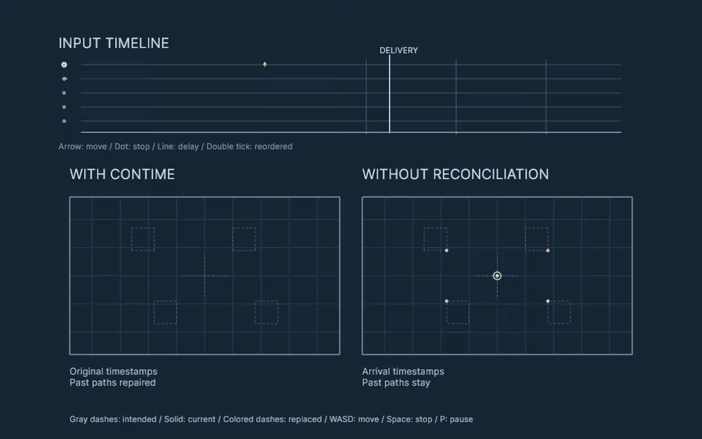

[](https://crates.io/crates/contime)
[](https://docs.rs/contime)
[](https://qlty.sh/gh/humacss/projects/contime)
[](https://qlty.sh/gh/humacss/projects/contime)

> **Work in progress:** ConTime is still being developed for my own use. There is more cleanup to do, and the API needs further refinement before it is ready for general adoption. You are welcome to try it, but expect changes and rough edges.

`contime` is an in-memory Rust library that builds queryable continuous-time state from unreliable event streams.

It handles delayed, duplicated, and out-of-order events, and distributes independent snapshot histories across workers.

## Reconciliation in action

[][browser-demo]

**[Play the interactive browser demo][browser-demo]** — click the map, then use WASD or the arrow keys. Space stops your client.

The same delayed inputs feed two views: **ConTime repairs past paths on the left**;
**arrival-time movement keeps its errors on the right**. Four simulated clients
and one keyboard-controlled client move inside a fixed arena. The interactive demo uses 500 ms average input latency and ±500 ms jitter
(0–1,000 ms per input). **Each client has
its own color**. Faint gray dashes show the intended routes; **fading dashed paths in each client’s color** show earlier rendering states that changed when
late inputs arrived. The timeline shows each action and its delivery delay;
double delivery ticks mark out-of-order arrivals. The ten-second recording uses choreographed
inputs and delivery delays, including player trips out from the center and back along both axes,
to make these corrections easy to follow; the
interactive demo generates its own traffic.

Markers ease between queried positions. Each update is checked against an
independent reference. The [Bevy presentation](examples/support/graphics/README.md)
is shared across desktop and browser hosts.

To run it from a checkout, first install the [browser prerequisites](examples/environments/browser/README.md#build-directly),
including Rust 1.95 for the isolated graphics example and the matching wasm-bindgen CLI.
ConTime itself requires Rust 1.90. Then start the example launcher:

```sh
cargo run --example launcher
```

Choose **Browser → Manual → Client movement**. Click the map to control a client
with WASD or the arrow keys; Space stops it. The launcher lets you choose client
count and simulated latency before starting. See the [browser setup](examples/environments/browser/README.md#build-directly)
and [recording settings](guides/usage/README.md#reproduce-the-reconciliation-recording),
or try the [terminal version](examples/cases/client_movement/README.md).

## Performance

ConTime is built for throughput as well as reconciliation. On the author's
Apple M3 Pro, the public API benchmark processed **about 5.2 million simple
counter events per second with one worker**, submitting events individually.
That includes submission, routing and processing; event construction and runtime
startup are outside the measurement.

A separate order-sensitive hash workload, with 64 snapshot histories and
submissions of 1,000 events, recorded:

| Worker threads | Total throughput |
| ---: | ---: |
| 1 | 4.0 million events/s |
| 2 | 8.0 million events/s |
| 4 | 17.9 million events/s |

These local release-mode measurements were recorded on 2026-10-28 with Rust
1.90.0, unpinned threads and normal desktop background activity. Throughput
depends on your event logic, snapshot targets, late arrivals and query load.
See the [pipeline benchmarks](benches/README.md) and
[matched scaling results](benches/scaling/README.md) for workloads, timing
boundaries and reproduction commands.

## Continuous Time?

Most systems today work with **discrete state**: "**right now** the state is X".

`contime` takes a different approach: it builds and maintains **continuous-time state**.

This means that state is defined **at every point in time**, not only at the moments when events arrive, but also in between those events, before those events, and after those events, within the retained history.

Now you can ask the question, what was the state at time `T`?

This also helps handle out-of-order events cleanly. What if an event comes in late?

Many systems will struggle to handle this because all you have is the current state. You don't know what the state looked like at the time the event was supposed to arrive.

With continuous-time state, applying an event from the past is as natural as applying one in the present. Histories order retained events by time and event ID, so the result does not depend on their arrival order. Your event application logic supplies the deterministic state changes.

## Target Use Cases

`contime` was originally built for the needs of a high-performance authoritative game server, but it is generally useful for systems that require historical state and out-of-order event processing.

Typical good fits include:

**Multiplayer game servers and clients**  
Maintain deterministic historical state for delayed, duplicated, or out-of-order player inputs.

**IoT & sensor network data**  
Apply readings from unreliable devices and networks into a consistent, queryable timeline.

**Audit trails & lightweight event-sourcing**  
Provide time-travel queries without needing a full persistent event store.

## Using `contime`

ConTime 0.1.2 supports Rust 1.90 or newer. Enable `macros` to assemble trait-based events and snapshots into
composable modules with `ContimeModule`:

```toml
[dependencies]
contime = { version = "0.1.2", features = ["macros"] }
```

An **event** describes a timestamped change. A **snapshot** defines state and how
it applies those changes. A **module** combines snapshots, inferring their events and shared time.
The [README walkthrough](examples/readme.rs) builds an ordered list:

```rust
use contime::prelude::*;

// This ID uniquely identifies the event; duplicate submissions are ignored.
#[derive(ContimeEvent)]
struct Value {
    #[contime(id)]
    event_id: u128,
    list_id: u128,
    #[contime(time)]
    time: i64,
    value: char,
}

// Register Value events. Their list_id selects the snapshot
// with the same list_id.
#[derive(Clone, Default, ContimeSnapshot)]
#[contime(events = [Value])]
struct List {
    #[contime(id)]
    list_id: u128,
    #[contime(time)]
    time: i64,
    values: Vec<char>,
}

// Append each value to its list.
impl SnapshotApply for List {
    fn apply_batch(&mut self, batch: impl ApplyContext<Self>) {
        for event in batch.events::<Value>() {
            self.values.push(event.value);
        }
    }
}

#[derive(ContimeModule)]
#[contime(snapshots = [List])]
struct Lists;
```

ConTime initializes each list from the event's `list_id` and uses `Default`
for the remaining fields. It replays state when earlier events arrive late.
With configuration supplied by your application, the basic flow is:

```rust
let contime = ConTime::<Lists>::start(config)?;
// Submission order is c, a, b; timestamps put them in a, b, c order.
contime.apply([
    Value { event_id: 1, list_id: 7, time: 30, value: 'c' }.into(),
    Value { event_id: 2, list_id: 7, time: -10, value: 'a' }.into(),
    Value { event_id: 3, list_id: 7, time: 10, value: 'b' }.into(),
]).map_err(api_error)?;
contime.advance_to(30).map_err(api_error)?;
// A controlled demonstration: finish processing before checking the result.
contime.wait_until_idle(std::time::Duration::from_secs(5))?;
let snapshots = contime.query_at(30, [7]).map_err(api_error)?;
let ListsSnapshotLanes::List(list) = &*snapshots[0];
assert_eq!(list.values, ['a', 'b', 'c']);

fn api_error(error: contime::ApiError) -> std::io::Error {
    std::io::Error::other(format!("ConTime request failed: {error:?}"))
}
```

`apply` queues work; queries observe available admitted history. The complete
walkthrough inserts `c`, `a`, then `b` individually, waits for replay between
insertions, and asserts each queried result. It also retries an event to verify
that the final list remains `['a', 'b', 'c']`. Idle waits are test/benchmark
helpers; live applications should use operation-specific responses or progress.

```sh
cargo run --example readme --features macros
```

The [complete single-file example](examples/readme.rs) includes configuration,
error handling, intermediate assertions, and shutdown. Then explore
[composite Content IDs](examples/composite_ids.rs),
[event registration overrides](examples/event_registration.rs),
[handwritten traits without macros](examples/explicit_traits.rs), or
[module composition](examples/modules.rs), or
[module-local event subsets](examples/module_subsets.rs). These teaching examples are separate
from the [live counter, hash-chain and movement cases](examples/README.md).

Runtime and built-in integer time support are enabled by default. The
[module walkthrough](guides/modules/README.md) explains module dependencies,
custom identities and negative timestamps; the [explicit trait guide](guides/usage/README.md)
shows the underlying contracts.

Manual processing (`manual`), monitoring (`monitor`),
and simulation (`simulator`) are opt-in. Monitoring automatically enables worker
application counts; there is no separate counters feature.
**Runtime** manages background threads when started. If your application owns the
loop, **Manual** lets you call `process()` between other tasks, including in a browser.
See [Manual processing and lean builds](guides/usage/README.md#run-contime-manually).

## How it Works

A **snapshot** describes state; an **event** describes a timestamped change to it.
Your application defines how to apply those changes. ConTime reconstructs state
at a requested time by starting from a saved **checkpoint** and applying the
remaining events in timestamp and event-ID order.

When an event arrives late, ConTime places it in the right position and rebuilds
the affected history. Independent histories can run on different workers. The
[mechanics guide](guides/how-it-works/README.md) explains application, queries,
checkpoints, routing and retention in detail.

## What to know before using it

ConTime keeps state in memory. Your application supplies deterministic event
application, stable IDs and persistence if needed. Queries are limited to retained
history; once older events are pruned, their states cannot be reconstructed.
See the [current constraints](guides/workspace/README.md#current-constraints).

## Read more

| Guide | What you will find |
| --- | --- |
| [Using ConTime](guides/usage/README.md) | Complete walkthrough, configuration, features and Manual processing |
| [How it works](guides/how-it-works/README.md) | Events, snapshots, queries, replay, checkpoints and retention |
| [Workspace](guides/workspace/README.md) | Crate responsibilities, constraints and verification commands |
| [Examples](examples/README.md) | Counters, hash-chain verification and client movement across hosts |
| [Rust API documentation](https://docs.rs/contime) | Public types, methods and completion contracts |
| [Benchmarks](benches/README.md) | Commands, recorded results and links to component measurements |

## License

[MIT](LICENSE)

[browser-demo]: https://humacss.github.io/contime/?domain=client-movement&clients=5&client_spacing=16&movement_speed=12&input_hz=1&query_hz=20&average_latency_ms=500&jitter_ms=500&trail_ms=5000&fade_ms=5000&retention_ms=10000&checkpoint_interval=128&max_ms=2&max_steps=1000&autostart=1
