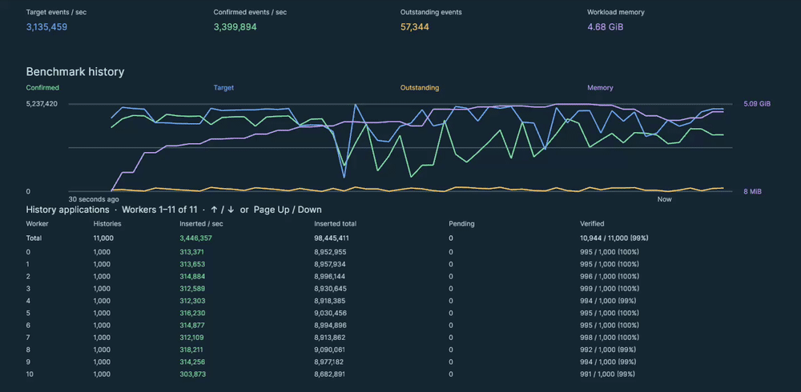

[](https://crates.io/crates/contime)
[](https://docs.rs/contime)
[](https://qlty.sh/gh/humacss/projects/contime)
[](https://qlty.sh/gh/humacss/projects/contime)

> **Work in progress:** `contime` is still being developed for my own use. There is more cleanup to do, and the API needs further refinement before it is ready for general adoption. You are welcome to try it, but expect changes and rough edges.

[][browser-demo]

`contime` is a Rust library for building **continuous-time state from unreliable
event streams**.

Independent processes often communicate by sending messages that describe changes:
a player moves, a sensor reports a reading, or a service changes status. Network
delivery and processing can delay those messages or cause them to arrive out of order.

Keeping state consistent when changes arrive late often requires retaining history and
reapplying the changes that came after them. `contime` handles that reconciliation
for you: define your events, your snapshots, and how the events change them, and
`contime` reconstructs the affected state in timestamp order.

You can query that state at any time within your retained history, whether now,
ten seconds ago, or between events. A rendering or processing loop can repeatedly
query the state it needs while `contime` handles late and out-of-order events.

`contime` is designed for performance. It can distribute independent histories across
CPU cores and process millions of events per second in benchmarks.

## How `contime` works

`contime` applies events to snapshots that hold your application state. Each event
has a timestamp and can target one or more snapshots. It is applied at its timestamp,
whether it arrives on time or late.

When a late event changes a snapshot, `contime` replays the affected later events up
to the current processing target.

Many systems keep only the latest state or update state at fixed ticks. `contime`
maintains a continuous window of history, with a configurable retention horizon
that controls how far back history is kept. Within that window, you can reconstruct
a snapshot at any time your timestamp type can represent, including between events.
This is the continuous time in `contime`.

Your application advances a processing target, typically the current time. Events
beyond that target remain stored for future live processing, while older history
outside the retention window is eventually pruned from memory and can no longer be
queried.

For the same admitted events, state at a given time is deterministic regardless of
arrival order. See [how `contime` works](guides/how-it-works/README.md) for queries,
checkpoints, workers, and retention.

The demo above shows this in action: `contime` corrects the path on the left, while
the right applies inputs on arrival and its path drifts.

**[Play the demo][browser-demo]** ·
[Read about the example](examples/cases/client_movement/README.md) ·
[View the code](examples/cases/client_movement/model.rs)

To run the example launcher from a repository checkout:

```sh
cargo run --release --example launcher
```

## Use cases

The same event and snapshot model can be used across applications:

- **Multiplayer games:** reconstruct and render state from delayed player inputs.
- **Robotics:** maintain a queryable world estimate as sensor results arrive at different times.
- **IoT and services:** reconstruct device state or service uptime from delayed reports.
- **Historical application state:** query past state without building replay yourself.

`contime` runs in memory. Your application supplies the events and update logic, as
well as any networking or persistence it needs. Local workers process independent
histories; communication and coordination across machines remain the application's
responsibility.

## Using `contime`

`contime` 0.1.2 requires Rust 1.90 or newer. Local Runtime worker threads are enabled
by default; enable the optional macros for the helpers shown here:

```toml
[dependencies]
contime = { version = "0.1.2", features = ["macros"] }
```

The [complete list example](examples/readme.rs) defines a `Value` event
with an ID, timestamp, target list and character, and a `List` snapshot that stores
those characters. Derives handle identity, time and event registration. The
application rule and module are:

```rust
use contime::prelude::*;

impl SnapshotApply for List {
    fn apply_batch(&mut self, batch: impl ApplyContext<Self>) {
        for event in batch.events::<Value>() {
            self.values.push(event.value);
        }
    }
}

#[derive(ContimeModule)]
#[contime(snapshots = [List])]
struct Lists;
```

Start `contime` and submit values in the order **c, a, b**. Their timestamps put
them in **a, b, c** order:

```rust
let contime = ConTime::<Lists>::start(configuration())?;
contime.apply([
    Value { event_id: 1, list_id: 7, time: 30, value: 'c' }.into(),
    Value { event_id: 2, list_id: 7, time: -10, value: 'a' }.into(),
    Value { event_id: 3, list_id: 7, time: 10, value: 'b' }.into(),
]).map_err(api_error)?;
contime.advance_to(30).map_err(api_error)?;
contime.wait_until_idle(std::time::Duration::from_secs(5))?;

let snapshots = contime.query_at(30, [7]).map_err(api_error)?;
let ListsSnapshotLanes::List(list) = &*snapshots[0];
assert_eq!(list.values, ['a', 'b', 'c']);
```

These are excerpts: the [full source](examples/readme.rs) includes the data
definitions, configuration, error handling and shutdown. It submits each event
separately and checks the result after each insertion, then retries an event to
show that duplicate IDs are ignored. Its idle waits make the assertions easy to
follow; live applications use operation-specific responses or progress.

```sh
cargo run --example readme --features macros
```

## Performance

`contime` routes independent snapshot histories across local worker threads and uses
checkpoints to reduce repeated replay. On an Apple M3 Pro, the public API
benchmark processed **about 5.0 million simple counter events per second with one
worker**, submitting events individually.
This includes submission, routing and processing, excluding event construction and
runtime startup.

A separate order-sensitive hash workload, with 64 snapshot histories and batches
of 1,000 events, recorded:

| Worker threads | Total throughput |
| ---: | ---: |
| 1 | 4.0 million events/s |
| 2 | 8.1 million events/s |
| 4 | 16.3 million events/s |

These release-mode benchmarks were recorded on 2026-11-04 with Rust 1.90.0,
unpinned threads and normal desktop background activity. They were measured at
revision `f75043f`, before the current worker changes, and use finite workloads
rather than sustained example throughput.

End-to-end examples currently achieve lower throughput than these benchmarks. They
include work the benchmarks do not fully exercise, such as event generation, queries
and pruning retained history. Memory use, pruning and multi-worker scaling still need
performance improvements.



*Benchmark example on an Apple M3 Pro with the default Maximum settings: 11 workers and 11,000 histories, recorded after the retention horizon.*

See the [pipeline benchmarks](benches/README.md) and [scaling results](benches/scaling/README.md)
for the measured workloads and commands. You can also run the Benchmark example through
the launcher to try an end-to-end workload on your own machine.

## Beyond games

`contime` can also reconstruct state from delayed sensor readings, service reports,
and other event streams. Your application defines the events and state updates,
while `contime` handles the history and replay.

## Where to go next

| I want to… | Read |
| --- | --- |
| Define events, snapshots, IDs and composable modules | [Application and macro guide](guides/modules/README.md) |
| Configure `contime` or drive Manual processing from my own loop | [Usage guide](guides/usage/README.md) |
| Understand queries, replay, checkpoints and retention | [How `contime` works](guides/how-it-works/README.md) |
| Try the live examples or run them in WebAssembly | [Examples](examples/README.md) |
| Explore throughput and reproduce measurements | [Benchmarks](benches/README.md) |
| Find API details | [Rust documentation](https://docs.rs/contime) |
| Understand the codebase and current limitations | [Workspace guide](guides/workspace/README.md) |

[MIT license](LICENSE)

[browser-demo]: https://humacss.github.io/contime/?domain=client-movement&clients=5&client_spacing=16&movement_speed=12&input_hz=1&query_hz=20&average_latency_ms=1000&jitter_ms=1000&trail_ms=5000&fade_ms=5000&retention_ms=10000&checkpoint_interval=128&max_ms=2&max_steps=1000&autostart=1
